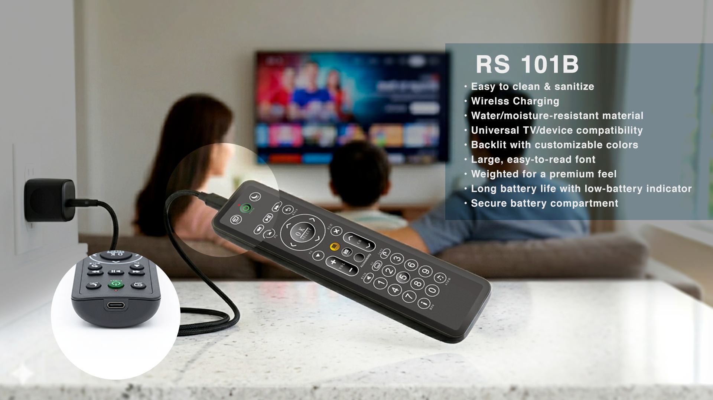
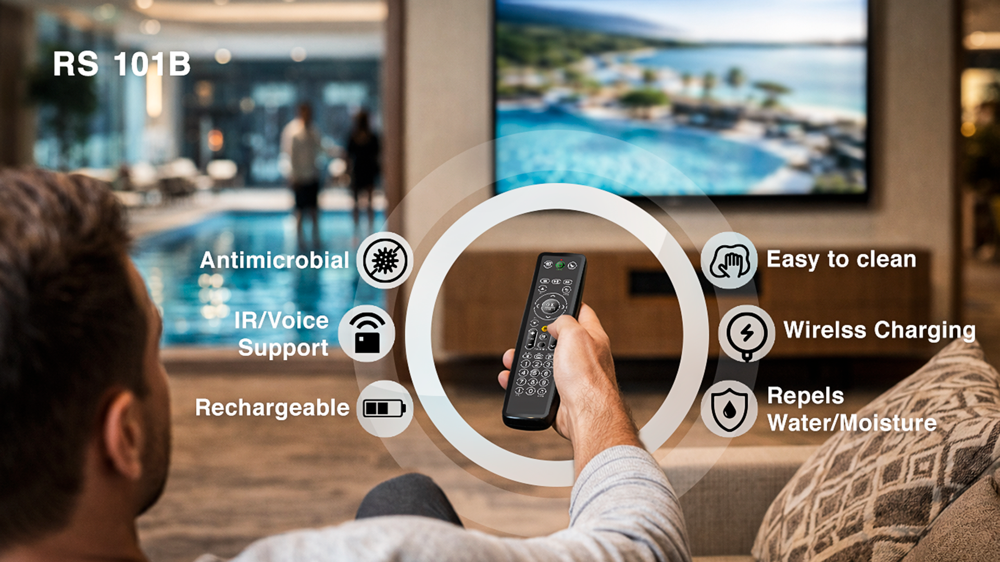
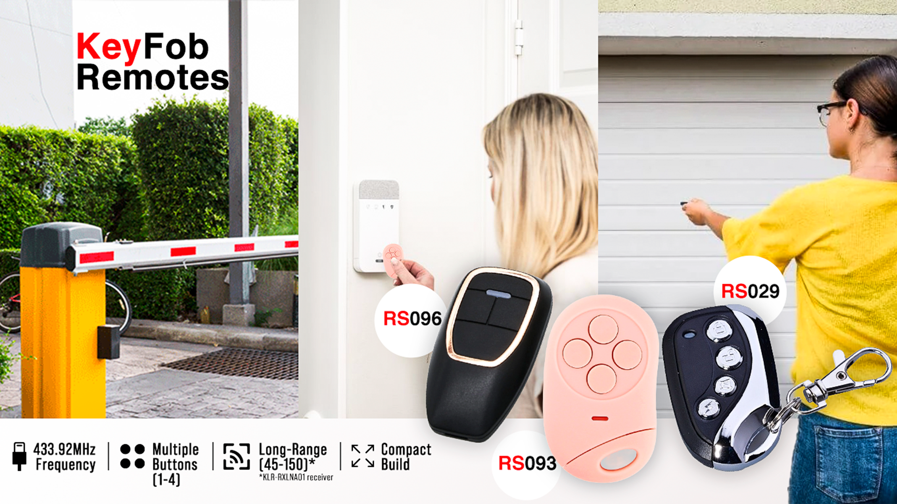

# Custom OEM Remote Control Designs | IR, RF, Bluetooth & LoRa Solutions

**[Project Homepage (GitHub Pages)](https://remote-source.github.io/Custom-Remote-Control-Designs/)** · **[Explore the Design Gallery](#screenshots-and-design-previews)** · **[Custom Remote Control Solutions](https://www.remotesource.net/full-feature-custom-remotes/)** · **[Request a Quote](https://www.remotesource.net/contact-us/)**

Explore customizable **OEM remote controls**, **universal TV remotes**, **RF key fobs**, **Bluetooth remotes**, **LoRa controllers**, and **cleanable remote control designs** for commercial and industrial applications.

## Screenshots and Design Previews

| Custom OEM remote controls | Cleanable commercial remote designs | RF key fob and gate controls |
| :---: | :---: | :---: |
| [](./Custom-Remote-Controls.png) | [](./OEM-cleanable-control-design-1.png) | [](./Custom-RF-keyfob-gate-remote-control.png) |
| [View OEM designs](#custom-oem-ir-and-universal-remotes) | [View cleanable remotes](#cleanable-and-antimicrobial-remote-designs) | [View RF controls](#rf-key-fobs-and-gate-controllers) |

## Quick Start: Browse the Design Assets

This repository is a **remote control design and product reference gallery**, not a software SDK. No API keys, libraries, firmware build, or device installation are required to browse its images and specifications.

```bash
# Download the product design and specification repository
git clone https://github.com/Remote-Source/Custom-Remote-Control-Designs.git
cd Custom-Remote-Control-Designs

# Optional: browse the files locally (requires Python 3)
python3 -m http.server 8000
# On Windows, you can use: py -m http.server 8000
# Then visit http://localhost:8000/ in a browser
```

Prefer not to clone? Browse the [repository files on GitHub](https://github.com/Remote-Source/Custom-Remote-Control-Designs/tree/main), or jump to the [design categories](#design-and-feature-library) below.

**Example project brief** (illustrative JSON to share with our team; **not** an API request):

```json
{
  "application": "hotel guest-room TV and IPTV",
  "remote_type": "custom universal remote",
  "control_options": ["IR", "RF"],
  "customization": ["button layout", "logo", "device codes"],
  "estimated_quantity": 1000,
  "notes": "Confirm compatibility, artwork and programming requirements"
}
```

## About

Custom OEM IR, RF, Bluetooth and LoRa remote controls for hospitality, AV, healthcare and industrial applications.

**Remote Source** supports custom remote control design, replacement remote development, button and housing customization, product branding, programming requirements, and OEM manufacturing discussions. Examples in this repository illustrate possible form factors and product categories; final capabilities depend on the selected design and project specifications.

## Applications and Use Cases

| Industry / Application | Example customization |
| --- | --- |
| **Hotels, resorts and cruise ships** | Simplified TV and IPTV layouts, branded guest remotes, replacement programs |
| **Hospitals and senior living** | Cleanable or antimicrobial remote options, larger buttons, streamlined operation |
| **Consumer electronics and AV** | IR/universal control, Bluetooth options, voice-control and device-specific layouts |
| **Gates, access control and security** | Compact RF key fobs, dedicated control buttons and receiver matching |
| **Industrial, agricultural and IoT systems** | RF or LoRa form factors for equipment, gates and irrigation applications |
| **OEM and private-label products** | Custom enclosures, legends, branding, button layouts and project-specific functions |

## Design and Feature Library

### Custom OEM, IR and Universal Remotes

Explore programmable and replacement-oriented layouts for TVs, IPTV, entertainment systems and other controlled devices.

- [Custom remote control design overview](./Custom-remote-control.png)
- [OEM remote control design example](./OEM-Remote-Control-Design.png)
- [Custom keypad remote example](./Custom-keypad-remote-control-1.png)
- [RS-536 universal remote control](./RS-536-universal-remote-control.png)
- [Apple TV remote design reference](./Apple-TV-Remote-Control.jpg)

### Cleanable and Antimicrobial Remote Designs

Explore cleanable enclosure concepts and commercial remote layouts for hospitality, healthcare and senior living applications. Antimicrobial properties, if required, should be confirmed for the specific model and materials.

- [Cleanable OEM remote example](./OEM-cleanable-control-design-1.png)
- [RS-571 cleanable universal remote](./RS-571-cleanable-universal-remote-control.png)
- [RS-577 cleanable universal remote](./RS-577-Cleanable-universal-remote-control-2.png)
- [Antimicrobial remote control design collection](./antimicrobial-remote-controls.png)

### RF Key Fobs and Gate Controllers

Review key fob housings, gate control layouts and RF remote examples. Frequency, protocol and receiver compatibility must be established during specification review.

- [Custom RF key fob design](./Custom-RF-keyfob-remote-control-1.png)
- [RF gate key fob design](./Custom-RF-keyfob-gate-remote-control.png)
- [RF gate key fob variation](./Custom-RF-keyfob-gate-remote-control-2.png)
- [RF remote control example](./RF-remote-control.jpg)
- [RF gate controller demonstration video](./RemoteSource-RF-Gate-Controller.mp4)

### LoRa and Long-Range Remote Designs

Reference form factors for industrial, agricultural, irrigation and gate-control applications. Radio performance depends on the selected hardware, environment and applicable regulations.

- [Industrial LoRa remote design](./custom-LoRa-industrial-remote-control.png)
- [Alternative industrial LoRa layout](./custom-LoRa-industrial-remote-control-2.png)
- [LoRa irrigation remote design](./custom-LoRa-irrigation-remote-control.png)
- [LoRa gate remote design](./custom-LoRa-gate-remote-control.png)

### Voice, Wireless Charging and Specialty Designs

- [RS-592 voice remote design](./RS-592-voice-remote-control.png)
- [OEM wireless charging remote example](./OEM-wireless-charging-remote-control-design-1.png)
- [Touchscreen remote design](./TouchScreen-Remote-Control.png)
- [RF-to-Wi-Fi converter image](./RF-to-wifi-converter-1.jpg)

## Reference Specifications and Product Documents

- [RS 101B product overview (PDF)](./RS%20101B%20OVERVIEW%202026.pdf)
- [RF616B / A0341 English specification (PDF)](./Remote_Source_RF616B_A0341_English_Only_Specification.pdf)
- [Remote Source RF receiver specifications repository](https://github.com/Remote-Source/RF-Receiver-Specification)

## From Concept to Custom Remote Control

1. **Define the use case:** device, operating environment and end-user needs.
2. **Select the control approach:** IR, RF, Bluetooth, LoRa or a project-specific combination.
3. **Customize the design:** key layout, enclosure, logo, labeling and interface requirements.
4. **Validate the requirements:** programming, receiver pairing, prototypes, testing and applicable certifications.
5. **Discuss production:** target quantities, timing, packaging and long-term replacement needs.

Explore [custom tooling and product development](https://www.remotesource.net/custom-tooling/) or [full-feature custom remote controls](https://www.remotesource.net/full-feature-custom-remotes/).

## Suggested GitHub Topics

Add these in the repository's **About → Topics** field (README text by itself does not set repository topics):

`remote-control` · `oem` · `custom-remote` · `ir` · `rf` · `bluetooth` · `lora` · `universal-remote` · `keyfob` · `iot` · `hardware-design` · `product-design` · `hospitality` · `healthcare` · `industrial-control` · `wireless`

---

> ### Need a Remote Control Designed for Your Product or Operation?
> **Remote Source** helps businesses customize remote controls to match their devices, users and environments—from OEM replacements and hospitality TV remotes to RF key fobs and specialty controllers.
>
> **Explore [RemoteSource.net](https://www.remotesource.net/) or [contact Remote Source for a custom quote](https://www.remotesource.net/contact-us/).**
